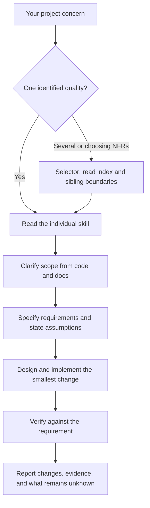

<div align="center">

# nfr-agent-skills

### Software quality workflows for your coding agent.

**114 Non-Functional Requirement skills. One selector. Scoped changes with explicit verification.**

[](https://github.com/JDULATE/nfr-agent-skills/actions/workflows/validate.yml)

**[v0.1.0 pre-release](https://github.com/JDULATE/nfr-agent-skills/releases/tag/v0.1.0) &middot; [115 draft skills](INDEX.md) &middot; [MIT license](LICENSE)**

[Quick start](#quick-start) &middot; [How it works](#how-it-works) &middot; [What you can work on](#what-you-can-work-on) &middot; [Example requests](#example-requests) &middot; [FAQ](#faq) &middot; [Documentation](#documentation)

<code>Clarify &rarr; Specify &rarr; Design/Implement &rarr; Verify &rarr; Report</code>

</div>

> [!IMPORTANT]
> All 115 skills are drafts. Terminology boundaries are repository conventions,
> not standardized definitions. Using a skill does not establish compliance,
> production readiness, or better implementation outcomes.

---

Give your coding agent a concern: users lose sessions on deploy, personal data
keeps reaching analytics, or a function is hard to follow. A relevant skill guides
the agent through reading the project, defining the requirement, making a scoped
change, and reporting what was checked.

The catalogue covers software quality concerns called **Non-Functional
Requirements (NFRs)**. Choose one skill for an identified concern, or use the
selector when you need help choosing and prioritizing several.

**[Browse the complete catalogue](INDEX.md)** or start with a request below.

## Quick start

You need a coding agent that can read Markdown and access your project's files.
Git is needed for cloning; Python is needed only for repository maintenance checks.

1. Download this repository or clone it:

   ```sh
   git clone https://github.com/JDULATE/nfr-agent-skills.git
   ```

2. Choose a skill from [INDEX.md](INDEX.md). Keep its entire folder, including
   `references/`, accessible to your agent.

3. In your project's agent session, give the agent the checkout path and a request:

   ```text
   Read skills/075-privacy/SKILL.md in the nfr-agent-skills checkout I provided.
   Follow its Workflow for this project: we keep sending email addresses to
   analytics, but we only use account IDs. Propose the smallest change that
   stops sending email addresses. State assumptions before building.
   ```

The intended result is a scoped proposal for the affected data flow, followed by
the authorized change and relevant checks. The agent should identify the producer
and recipient, state assumptions, and report what it verified and what remains
unknown. This is an example request, not a recorded successful implementation.

## How it works

A skill is a Markdown entrypoint with supporting references. Your agent reads
the chosen SKILL.md, inspects your code and docs, and follows its Workflow.
The instructions ask it to state assumptions before building, ask at most three
questions, and build the smallest version that meets your request.



Use the [disambiguation map](references/disambiguation-map.md) when terms overlap.
For an ambiguous single concern, ask a focused question before choosing a sibling.

The selector needs this bundle's `INDEX.md`, `selector.json`, and
`references/disambiguation-map.md`. If you copy its folder separately, also give
the agent the bundle path; its folder alone lacks those shared resources.

## What you can work on

These are repository navigation categories, not a standardized quality model.
Use [INDEX.md](INDEX.md) for all skills and their draft status.

| Area | NFR skills | Examples |
| --- | ---: | --- |
| Business & Fitness | 7 | [Affordability](skills/007-affordability/SKILL.md), [Effectiveness](skills/040-effectiveness/SKILL.md) |
| Correctness & Data Quality | 12 | [Accuracy](skills/003-accuracy/SKILL.md), [Certainty](skills/016-certainty/SKILL.md) |
| Design Structure & Flexibility | 14 | [Complexity/Interacting Complexity](skills/021-complexity-interacting-complexity/SKILL.md), [Composability](skills/022-composability/SKILL.md) |
| Maintainability & Evolvability | 20 | [Adaptability](skills/004-adaptability/SKILL.md), [Additivity](skills/005-additivity/SKILL.md) |
| Observability & Operability | 9 | [Analyzability](skills/009-analyzability/SKILL.md), [Controllability](skills/030-controllability/SKILL.md) |
| Performance & Efficiency | 5 | [Efficiency/Device Efficiency](skills/041-efficiency-device-efficiency/SKILL.md), [Performance/Efficiency/Time or Space Bounds](skills/072-performance-efficiency-time-or-space-bounds/SKILL.md) |
| Portability & Interoperability | 10 | [Compatibility](skills/019-compatibility/SKILL.md), [Installability](skills/055-installability/SKILL.md) |
| Reliability & Resilience | 12 | [Atomicity](skills/011-atomicity/SKILL.md), [Availability](skills/015-availability/SKILL.md) |
| Security & Privacy | 11 | [Accountability](skills/002-accountability/SKILL.md), [Anonymity](skills/010-anonymity/SKILL.md) |
| Usability & Comprehension | 14 | [Accessibility/Access Control](skills/001-accessibility-access-control/SKILL.md), [Attractiveness](skills/012-attractiveness/SKILL.md) |

The selector is separate from these 114 NFR skills.

## Install selected skills in Codex

According to [official OpenAI documentation](https://developers.openai.com/codex/skills),
Codex discovers skill names, descriptions, and paths, then reads the full
`SKILL.md` when selected. For project discovery, put complete skill folders in
`.agents/skills/` within your project. Codex scans these directories from its
working directory up to the repository root. The documented user-wide location
is `$HOME/.agents/skills`; symlinked skill folders are also supported.

For example, copy `skills/075-privacy/` into your project so it looks like this:

```text
your-project/
  AGENTS.md
  .agents/
    skills/
      075-privacy/
        SKILL.md
        references/
```

If you install only skill folders, copy the **Apply the skill** section of this
repository's [AGENTS.md](AGENTS.md#apply-the-skill) into your own project's
`AGENTS.md`. This repository's `AGENTS.md` is not read from your project merely
because the skill folders are installed.

In Codex CLI or the IDE extension, use `/skills` or a `$` mention with the skill's
frontmatter name, which omits the numeric folder prefix:

```text
$privacy Stop sending email addresses to analytics; we only use account IDs.
```

Codex can also select a skill from its description. Install only the skills you
need: large collections can have descriptions shortened or skills omitted from
the initial discovery list. This checkout's top-level `skills/` directory is not
itself a documented discovery location. The documented format and locations were
checked, but installation on another machine remains unverified.

For other agents, use the explicit-file approach in the quick start. Automatic
discovery, installation locations, and invocation syntax for other hosts have not
been verified here.

## Example requests

These are starting prompts, not recorded implementation results. The agent still
needs your project context and the relevant skill's checks.

### Keep sessions working through a deployment

Read [availability](skills/015-availability/SKILL.md), or invoke it after installation:

```text
$availability Users get logged out every time we deploy. Inspect how sessions
and shutdown work, propose the smallest fix, and tell me what you verified.
```

### Stop sending unnecessary personal data

```text
$privacy Stop sending email addresses to analytics; we only use account IDs.
Inspect the data flow and state your assumptions before making changes.
```

Start with [privacy](skills/075-privacy/SKILL.md) for purpose and lifecycle.
Use [confidentiality](skills/026-confidentiality/SKILL.md) when the question is
who may read protected information.

### Make a function easier to follow

```text
$readability Reduce nesting and rename confusing locals in this function.
Preserve its behavior and report which checks support that.
```

Read [readability](skills/078-readability/SKILL.md) for reading flow;
use the sibling boundaries when the issue is missing concepts or character recognition.

### Choose a small set of NFRs

```text
$nfr-selector Which NFRs matter for this service? Read the project, propose the
smallest useful set, and explain conflicts and the order of work.
```

Use the [selector](skills/000-nfr-selector/SKILL.md) for selection, broad readiness
requests, or several qualities together. Selecting skills does not verify readiness.

## FAQ

<details>
<summary><strong>Which coding agents can use these skills?</strong></summary>

An agent that can read Markdown can use a skill when you provide its SKILL.md,
references, and project access. Codex discovery and invocation are documented
above. Automatic installation and discovery for other hosts remain unverified.

</details>

<details>
<summary><strong>Should I install all 115 skills?</strong></summary>

Start with the skills your project needs. Codex can shorten descriptions or omit
skills from its initial discovery list when many are installed. Browse
[INDEX.md](INDEX.md) and retain the complete folders of your chosen skills.

</details>

<details>
<summary><strong>Do I need Python to use a skill?</strong></summary>

Reading these Markdown workflows does not require Python. Python is used by this
repository's validation and maintenance scripts. Tools needed to change or verify
your own project depend on that project.

</details>

<details>
<summary><strong>Will this make my project production-ready or compliant?</strong></summary>

The skills guide engineering work. They do not establish either conclusion.
All skills are drafts, and real-task evidence is limited. Review the
[evidence and limitations](#evidence-and-limitations) before relying on a result.

</details>

<details>
<summary><strong>Does the phased authoring process apply to using a skill?</strong></summary>

No. Follow [AGENTS.md](AGENTS.md) when applying a skill to your project.
[CONTRIBUTING.md](CONTRIBUTING.md) covers changes to this repository.

</details>

## Evidence and limitations

- All skills remain drafts. Repository validation checks structure and content
  constraints; it does not establish that workflows produce better implementations.
- Routing was tested on a small authored set and selected reruns, including
  **12 held-out prompts, with 11/12 accepted choices**. The remaining prompt
  concerned a recurring bug: the router chose maturity, while asking the user
  was judged better. This result is not a catalogue-wide accuracy estimate.
- Fast paths were exercised in a few manual scratch runs by the maintainer.
  A no-skills baseline behaved about the same on one task. Broad real-task
  coverage, independent replication, and deployment-level evidence are missing.
- About 175 audited transferable Rules of thumb bullets in batches 2–9 were not
  retrofitted; that earlier estimate was not independently recounted during
  release preparation. Also, 21 skills have only three Rules of thumb.
  Public follow-up: [rule retrofit #1](https://github.com/JDULATE/nfr-agent-skills/issues/1),
  [design depth #2](https://github.com/JDULATE/nfr-agent-skills/issues/2), and
  [real-task evidence #3](https://github.com/JDULATE/nfr-agent-skills/issues/3).
- Host compatibility is not established by repository validation. Every skill's
  frontmatter contains only `name` and `description`; draft status lives in the
  catalogue.

The [final report in the repository](https://github.com/JDULATE/nfr-agent-skills/blob/master/reviews/final-report.md)
contains counts, routing provenance, uncertain claims, and known weaknesses.
The `reviews/` directory is development evidence retained in Git and excluded
from Git archive exports, including release source archives.

## Documentation

- [Catalogue](INDEX.md): skill links and draft status.
- [Consumer guide](AGENTS.md): choosing, reading, and applying a skill.
- [Sibling boundaries](references/disambiguation-map.md): proposed distinctions between overlapping NFRs.
- [Authoring guide](references/authoring-guide.md): content and review requirements.
- [Quality rubric](references/quality-rubric.md): the repository's authoring quality bar.
- [Standards allowlist](references/standards-allowlist.md): citation constraints.
- [Contributing](CONTRIBUTING.md): maintenance workflow and validation commands.

## Repository layout

| Path | Contents |
| --- | --- |
| [skills/](skills/) | 114 NFR entrypoints and the selector, with local references |
| [INDEX.md](INDEX.md) | Generated catalogue with links and status |
| [nfr-list.json](nfr-list.json), [selector.json](selector.json) | Catalogue metadata and draft status |
| [references/](references/) | Terminology conventions, standards allowlist, authoring guide, and rubric |
| [evals/](evals/) | Routing fixtures, frozen keys, historical snapshots, and supplied results |
| [scripts/](scripts/), [tests/](tests/) | Validation, indexing, routing scoring, and maintenance tooling |

## Contributing and checks

Read [CONTRIBUTING.md](CONTRIBUTING.md) before changing a skill. It defines scope,
authoring phases, the quality rubric, and validation requirements. Run these
checks from the repository root with Python; the scripts use its standard library:

```sh
python scripts/validate_skills.py
python -m unittest discover -s tests
python scripts/build_index.py
```

A successful validator run reports zero errors; tests should report `OK`, and
the index builder should report 115 entries. CI runs on pushes and pull requests
and also checks that the generated index matches the committed file. A passing
check is not skill approval or evidence of better implementation outcomes.

Report defects or unclear sibling boundaries through
[GitHub issues](https://github.com/JDULATE/nfr-agent-skills/issues), with the skill
slug, request, observed behavior, and expected behavior.

## License

[MIT](LICENSE).
